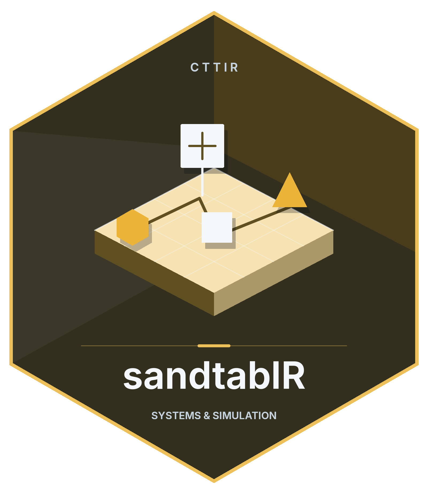

# sandtablR 

<!-- badges: start -->
[](https://github.com/cttir/sandtablR/actions/workflows/R-CMD-check.yaml)
[](https://lifecycle.r-lib.org/articles/stages.html#experimental)
[](https://opensource.org/licenses/MIT)
<!-- badges: end -->

A framework for mass-casualty incident tabletop **exercise simulation**,
**decision-path analysis** and **machine learning**, with an interactive
**Shiny workbench**.

Generate a casualty cohort, run it across a board, capture the decisions that
were made, then model and explain them.

## Installation

```r
# install.packages("remotes")
remotes::install_github("cttir/sandtablR")
```

R 4.1.0 or later is required. The core installation includes the simulation
and plotting dependencies. Modelling, explanations and sequence clustering
have optional dependencies; install the ones needed for your workflow.

**Development software.** Synthetic examples demonstrate interfaces and modelling
assumptions. They do not establish clinical validity or real-world performance.

## Quick start

```r
library(sandtablR)
co <- sdt_synthetic_cohort(n = 40, seed = 1)
sc <- sdt_scenario(co, resources = list(or = 3, icu_imc = 6, ward = 20))
run <- sdt_simulate(sc, replications = 5, seed = 1, verbose = FALSE)
summary(run, reference = TRUE)
head(sdt_decision_paths(run))
head(sdt_decision_consistency(run))
```

The event log records patient movement by replication and board area. Summaries
compare the simulated end state with a reference distribution; the comparison
is not an independent clinical validation. Seeds make this example repeatable
within the recorded software environment.

For a small optional modelling example, install the listed dependencies first:

```r
# install.packages(c("parsnip", "recipes", "workflows", "rsample", "tune",
#                    "yardstick", "dials", "hardhat", "rpart"))
labelled <- sdt_add_decisions(co, seed = 2)
fit <- sdt_fit(labelled, target = "called_triage", engine = "tree",
               tune = FALSE, folds = 3, seed = 1, verbose = FALSE)
sdt_metrics(fit)
```

Launch the interactive workbench separately:

```r
# Install the suggested Shiny dependencies listed in DESCRIPTION if needed.
sdt_run_app()
```

## What is in it

**A data model.** A casualty is a patient card; an ordered set of them is a
cohort; a cohort plus board capacities is a scenario. Cohort validation is
vectorised over columns, so a bad import names every offending row and column
at once instead of aborting on the first.

**A simulation engine.** A discrete-event model over the board, routing each
casualty by sighting category and therapy concept. It records a per-area event
log, which is what makes full decision paths available downstream. The default
horizon and board capacities were calibrated so the end-of-game distribution
reproduces the published one; `sdt_reference_scenario()` builds that board, and
the test suite re-runs the comparison rather than asserting it.

**Decision-path analysis.** Pathways as state sequences, with optimal-matching
distances, clustering into characteristic routes, and consistency scored as
distance between a casualty's replications rather than agreement on one label.

**A model bench.** One interface over interpretable engines (`glmnet`, a
decision tree) and black-box ones (`ranger`, `xgboost`), all trained through
the same recipe and scored on the same held-out split, so performance can be compared under the same evaluation design.

**Explainability.** Permutation importance, dependence profiles and
per-casualty SHAP attributions via DALEX, all model-agnostic, so a tree and a
forest can be compared on one footing.

**A workbench.** Seven panels covering the whole workflow, plus a one-click
self-contained HTML report of the session. The app's modules are ordinary
package functions in `R/`, not scripts under `inst/`, so they are checked,
linted, covered and driven headlessly by the test suite.

## A note on what to predict

The card's true sighting category follows from life points by construction, so
every engine scores near 1 on it and a leaderboard says nothing. What is worth
modelling is what a *participant* called. `sdt_add_decisions()` generates those
calls using the published per-category hit rates (88% red, 59% yellow, 71%
green), which turns the bench into a real comparison. See
`vignette("model-bench")`.

## Authors

Raban Heller and Gerhard Achatz.

## Provenance

The domain model follows the TDSC tabletop exercise (Achatz et al. 2023,
*Eur J Trauma Emerg Surg* 49(2):607–617,
[doi:10.1007/s00068-022-02217-1](https://doi.org/10.1007/s00068-022-02217-1)).
`sandtablR` is a generic re-implementation built from the published
specification and general knowledge. It is not TDSC course software and
reproduces none of the course's materials. G. Achatz is a developer of the
TDSC course and an author of the evaluation the package calibrates against.

`sdt_reference()` keeps the values attributed to that publication separate
from `sandtablR`'s own modelling choices, so a calibration test cannot quietly
check the model against parameters we picked ourselves.

## Tutorials and reproducibility

- [Getting started](https://github.com/CTTIR/sandtablR/blob/main/vignettes/sandtablR.Rmd): cohort validation, simulation,
  decision paths, model fitting and saving results.
- [The model bench](https://github.com/CTTIR/sandtablR/blob/main/vignettes/model-bench.Rmd): a fixed, reproducible comparison
  of selected engines and the limits of model explanations.

Install with `remotes::install_github("CTTIR/sandtablR", build_vignettes = TRUE)`
to use `vignette("sandtablR", package = "sandtablR")` and
`vignette("model-bench", package = "sandtablR")`. Building tutorials requires
`knitr`, `rmarkdown` and Pandoc; optional modelling dependencies enable the
corresponding tutorial sections.

```r
path <- tempfile(fileext = ".rds")
saveRDS(list(scenario = sc, run = run, seed = 1,
             session = sessionInfo()), path)
restored <- readRDS(path)
stopifnot(identical(run$events, restored$run$events))
```

Keep the scenario, seeds, package revision and software environment together.
Synthetic data derived from real records are not automatically anonymous or
safe to release. Assess privacy separately from predictive utility.

## Troubleshooting, citation and licence

Validation errors identify invalid card fields; consult `?sdt_cohort` for the
schema. Optional-engine errors name the missing dependency. Start with the core
simulation before adding modelling or explanation packages.

Use `citation("sandtablR")` for installed-version metadata and cite the reference
publication when using its attributed values. Licensed under [MIT](LICENSE.md).
Report reproducible problems with synthetic inputs in
[GitHub issues](https://github.com/CTTIR/sandtablR/issues).

## Use of LLM tools

Where applicable, LLM tools were used for narrowly defined, non-authorial tasks:
copyediting, prose refinement, Markdown/LaTeX formatting, boilerplate scaffolding
(such as CI configurations and build scripts), and code refactoring. Tools included
[Chat AI](https://kisski.gwdg.de/leistungen/2-02-llm-service/), the KISSKI
(GWDG) service, and self-hosted **Mistral Small (24B, Apache-2.0)** served through
a local **vLLM architecture** on an Ubuntu Linux workstation with Intel
processors and NVIDIA GPUs. The self-hosted model ran locally, with no data sent
to third parties.

All scientific claims, methodological choices, analyses, interpretations and
conclusions remain the authors' own. Where applicable, LLM-generated material
must be reviewed and revised before inclusion, and references must be verified
against their DOI, arXiv ID or ISBN.

Local software setup: vLLM with Python/PyTorch, plus R and RStudio.

## Branding

Editable R artwork and regeneration instructions are in [tools/branding](https://github.com/CTTIR/sandtablR/blob/main/tools/branding/README.md).
