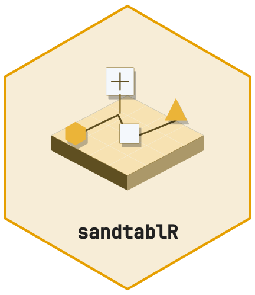
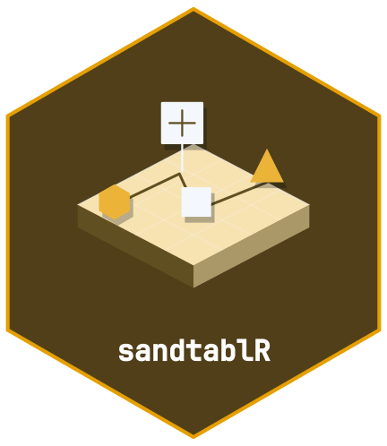

<!-- cttir-vignette-logo: start -->
<style>
.cttir-vignette-logo { float: right; width: 120px; max-width: 30%; margin: 0 0 1rem 1.5rem; }
.cttir-vignette-logo img { width: 100%; height: auto; border: 0; background: transparent; box-shadow: none; }
.cttir-vignette-logo .cttir-vignette-logo-light { display: block; }
.cttir-vignette-logo .cttir-vignette-logo-dark { display: none; }
@media (prefers-color-scheme: dark) {
  .cttir-vignette-logo .cttir-vignette-logo-light { display: none; }
  .cttir-vignette-logo .cttir-vignette-logo-dark { display: block; }
}
[data-bs-theme="light"] .cttir-vignette-logo .cttir-vignette-logo-light { display: block; }
[data-bs-theme="light"] .cttir-vignette-logo .cttir-vignette-logo-dark { display: none; }
[data-bs-theme="dark"] .cttir-vignette-logo .cttir-vignette-logo-light { display: none; }
[data-bs-theme="dark"] .cttir-vignette-logo .cttir-vignette-logo-dark { display: block; }
</style>
<div class="cttir-vignette-logo">
  
  
</div>
<!-- cttir-vignette-logo: end -->

```{r, include = FALSE}
knitr::opts_chunk$set(
  collapse = TRUE, comment = "#>",
  fig.width = 7, fig.height = 4, dpi = 96
)
has <- function(...) {
  all(vapply(c(...), requireNamespace, logical(1), quietly = TRUE))
}
tidymodels_ready <- has(
  "parsnip", "recipes", "workflows", "rsample", "tune",
  "yardstick", "dials", "hardhat", "rpart"
)
explain_ready <- tidymodels_ready && has("DALEX", "DALEXtra")
```

```{r setup}
library(sandtablR)
```

`sandtablR` is a framework for mass-casualty incident tabletop exercises:
generate a casualty cohort, run it across a board, capture the decisions that
were made, then model and explain them.

The steps below are the whole workflow. Everything the Shiny workbench does,
it does by calling these functions.

## 1. A cohort

A cohort is a validated tibble subclass. Every casualty carries a card:
demographics, life points, whether they are ventilated, the injury region, and
the true sighting category and therapy concept.

```{r cohort}
co <- sdt_synthetic_cohort(n = 40, seed = 1)
co
```

Marginals come from `sdt_reference()`, which separates two things that are easy
to conflate: values attributed to the published evaluation, and modelling
choices `sandtablR` made where the source does not pin one.

```{r reference}
sdt_reference("published")$triage_mix
```

Validation is vectorised over columns rather than looping over rows, so a bad
import reports everything wrong with it at once rather than one problem per
attempt:

```{r validate, error = TRUE}
bad <- co
bad$triage <- as.character(bad$triage)
bad$triage[c(2, 5)] <- "purple"
bad$life_points[3] <- 99
sdt_cohort(bad)
```

## 2. A scenario

A scenario is a cohort plus the board's resource capacities.

```{r scenario}
sc <- sdt_scenario(co, resources = list(or = 3, icu_imc = 6, ward = 20),
                   name = "concert")
sc
summary(sc)
```

```{r triage-mix, fig.alt = "Bar chart of casualties per sighting category", fig.cap = "Bar chart of casualties per sighting category. Synthetic demonstration."}
sdt_plot_triage_mix(sc)
```

## 3. Simulate patient flow

`sdt_simulate()` maps the scenario onto a discrete-event model and routes each
casualty by sighting category and therapy concept.

```{r simulate, eval = has("simmer")}
run <- sdt_simulate(sc, replications = 5, seed = 1, verbose = FALSE)
run
```

The engine's real output is the event log: one row per casualty per board area,
with when it entered and left.

```{r events, eval = has("simmer")}
head(run$events)
```

Three dispositions are terminal by design, and that is what reproduces the
published end-of-game distribution: critical care is where a casualty stays, a
ward bed is the end of the line, and a casualty who is worked up but not taken
to theatre is still being held in the emergency department when the game is
called.

The quickest way to see what the engine did is to look at the board. Every
casualty is a point in the area it had reached at that moment, laid out as the
nine areas of the published board. Change `at` and you watch the stream move
across it.

```{r board, eval = has("simmer"), fig.width = 8, fig.height = 3.4, fig.alt = "The nine board areas with casualties drawn as coloured points", fig.cap = "The nine board areas with casualties drawn as coloured points. Synthetic demonstration."}
sdt_plot_board(run, at = 150)
```

```{r end-state, eval = has("simmer")}
summary(run, reference = TRUE)
```

```{r end-plot, eval = has("simmer"), fig.alt = "Simulated end-of-game location against the published reference", fig.cap = "Simulated end-of-game location against the published reference. Synthetic demonstration."}
sdt_plot_end_state(run)
```

That calibration is checkable rather than asserted: `sdt_reference_scenario()`
builds the board the engine was tuned on, and the package's own test suite
re-runs the comparison.

## 4. Decision paths

Because the event log records every area entry, each casualty has a full
ordered pathway.

```{r paths, eval = has("simmer")}
head(sdt_decision_paths(run), 8)
```

`sdt_decision_consistency()` asks how repeatably the same casualty was handled
across replications, as a distance between its pathways rather than agreement
on a single label.

```{r consistency, eval = has("simmer")}
consistency <- sdt_decision_consistency(run)
head(consistency[order(consistency$consistency), ])
```

```{r sequences, eval = has("simmer"), fig.alt = "Share of casualties in each board area by position in the pathway", fig.cap = "Share of casualties in each board area by position in the pathway. Synthetic demonstration."}
sdt_plot_sequences(run, type = "distribution")
```

With **TraMineR** and **WeightedCluster** installed, `sdt_seq_cluster()` groups
pathways into a few characteristic routes through the board.

## 5. Model the decisions

The card's true category follows from life points by construction, so every
engine scores near 1 on it and the comparison says nothing. What is worth
modelling is what a *participant* called. `sdt_add_decisions()` simulates that
using the published per-category hit rates.

```{r decisions}
labelled <- sdt_add_decisions(co, seed = 2)
sdt_consistency_score(labelled$triage, labelled$called_triage)
```

```{r fit, eval = tidymodels_ready}
fit <- sdt_fit(labelled, target = "called_triage", engine = "tree",
               tune = FALSE, folds = 3, seed = 1, verbose = FALSE)
fit
sdt_metrics(fit)
```

`sdt_workflowset()` screens every installed engine onto one leaderboard, with
glass-box and black-box models side by side. See
`vignette("model-bench", package = "sandtablR")`.

## 6. Explain

Explanations are model-agnostic, so the same views work on a decision tree and
on a random forest.

```{r explain, eval = explain_ready, fig.alt = "Permutation variable importance", fig.cap = "Permutation variable importance. Synthetic demonstration."}
sdt_importance(fit, n_permutations = 5)
```

## The workbench

`sdt_run_app()` launches an interactive workbench over all of the above: build
a scenario, run the board, annotate decisions, train and compare models,
explain them, and analyse decision paths. It also renders the session to a
self-contained HTML report.

## Provenance

The domain model (sighting categories, ETC/DCS/TASC therapy concepts, board
areas, patient-card fields) follows the TDSC tabletop exercise as described in
the open-access evaluation by Achatz et al. (2023), *Eur J Trauma Emerg Surg*
49(2):607--617, [doi:10.1007/s00068-022-02217-1](https://doi.org/10.1007/s00068-022-02217-1). `sandtablR` is a generic
re-implementation built from published specifications, and is not affiliated
with the TDSC course.

## Save and reproduce a run

```{r save-results, eval=has("simmer")}
path <- tempfile(fileext = ".rds")
saveRDS(list(scenario = sc, run = run, seed = 1,
             session = sessionInfo()), path)
restored <- readRDS(path)
stopifnot(identical(run$events, restored$run$events))
```

Retain the software revision and scenario alongside every seed. A reproducible
simulation is not evidence that its assumptions describe a real incident.
See [the model bench](model-bench.html) for a separate synthetic prediction example.

## Software environment

```{r session-information}
sessionInfo()
```
